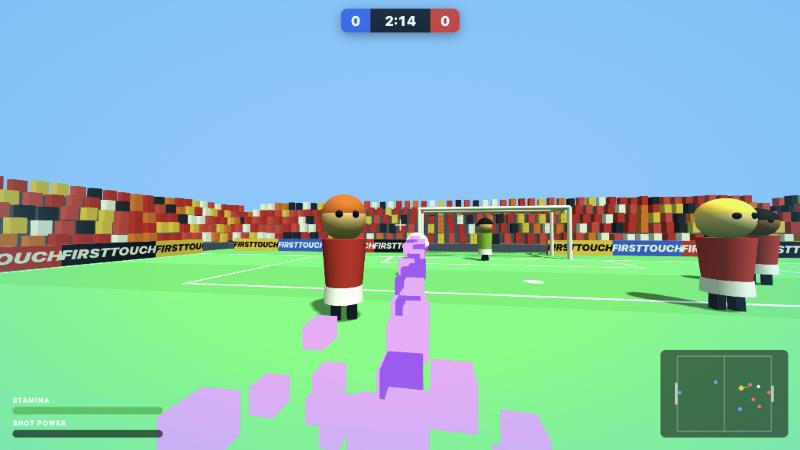

# FirstTouch

**Arcade 4v4 football, in first person.** You're the blue striker: bend shots around the keeper, double jump into flying headers, catch the ball mid-air in bullet time, and blast super shots that flatten anyone in their way.

▶ **Play it now: [firsttouch-henna.vercel.app](https://firsttouch-henna.vercel.app)**



It isn't realistic. It's built to be fun: a floaty, bouncy ball, walls instead of throw-ins, and a goalie who gets knocked flat when you hit it hard enough.

---

## Controls

| Input | Action |
|---|---|
| **WASD** | Move. Strafing (A/D) is extra quick. |
| **Mouse** | Look |
| **Shift** | Sprint. Tap it mid-air to **dash** forward. |
| **Space** | Jump. Press again mid-air to **double jump**. Jumping calls a nearby loose ball to you. |
| **Hold / release left click** | Charge and shoot where you look. A full charge fires a **super shot** right away. |
| **A / D while charging** | **Curve** the shot. You stop strafing so you can aim, and the ball bends in slow motion. |
| **Right click / Q** | Pass to the teammate you're facing |
| **E** | Slide tackle. Mid-air, it's a flying dive. Winning the ball gives you 1 s of immunity. |
| **F** | Flick the ball up, then jump and head it or volley it |
| **Esc** | Pause, which also shows the controls |

## How it plays

**The ball**
- Low gravity and big bounces, so the ball spends most of its time in the air.
- A high ball near you is gently **magnetized** toward your head.
- Anything that reaches head height on the ground gets **headed** toward where you're looking.

**In the air**
- **Mid-air catch:** collect the ball while airborne and the game drops into **bullet time**. Shoot before you land, or land with the ball still at your feet.
- **Double jump** and **air dash** give you big aerial plays.

**Shooting**
- **Curve:** hold A or D while charging. The ball bends hard and time slows while it curls.
- **Super shot:** a full charge fires immediately, so you can't sit at full charge and aim. Super shots knuckle (wobble unpredictably), bulldoze field players and lose their power when they hit a wall. A goalie in the ball's path can still stop one.

**The AI**
- **Teammates** pass to you first, aiming where you'll be when the pass arrives, based on your speed and direction. Your goalie never holds the ball and feeds it straight to you.
- **Opponents** shoot early and often from anywhere around the box, and aim for the far post. When you have the ball near their box, their defenders swarm you and jump-tackle if you're in the air.
- **Their goalie** comes off its line to tackle you when you're close and has better odds of a big save at close range. Curled shots fool it half the time.

**Match flow**
- 3-minute matches.
- Every kickoff is a **jump ball**: the ball is tossed to head height and the nearest red player leaps for it.
- Your goal is a bit bigger than theirs, which gives red a fighting chance.

## Running it locally

The whole game is one self-contained `index.html`. There's no build step and nothing to install, though Three.js loads from a CDN, so you need an internet connection.

```bash
git clone https://github.com/rayhanrinzan/firsttouch.git
cd firsttouch
open index.html            # or: python3 -m http.server 8765
```

If your browser is strict about local files, use the local server and open http://localhost:8765. The game is best in desktop Chrome with a mouse and keyboard, and it needs pointer lock to look around. There are no touch controls.

## Deploying

The game is hosted on [Vercel](https://vercel.com) as a static site:

```bash
vercel deploy --prod
```

To deploy automatically on every push, connect this repository to the Vercel project under **Settings → Git**.

## Under the hood

- **[Three.js](https://threejs.org) r128** for rendering. Everything is generated in code: the pitch, crowd, goals and players are primitives, and the textures are drawn on `<canvas>`. There are no image or model files.
- **Custom physics, no physics library:**
  - Ballistic ball flight with drag, spin-based curve, knuckle wobble and bounces off walls, posts and nets.
  - Fast shots are substepped so they can't pass through posts or players.
- **AI:** a simple per-bot state machine (carry, shoot, pass, cross, chip, chase, support) plus goalie logic for positioning, dives, rushing out and tackling. Lob passes are solved exactly for gravity and drag, so they land where they're aimed.
- **Audio:** every sound (kicks, posts, whistle, crowd swell) is synthesized live with the Web Audio API.

The ball gravity (`GRAV`), pitch size (`W`/`H`) and goal sizes (`gw`/`gh`) are named constants near the top of the script. Shot power is set in `releaseShot`, and the magnet strength is set in `updateBall` and `callBall`. Tweak them to make the game your own.

## Project layout

```
index.html          the entire game: HTML/CSS HUD, Three.js scene, physics, AI, audio
docs/screenshot.jpg README screenshot
```
